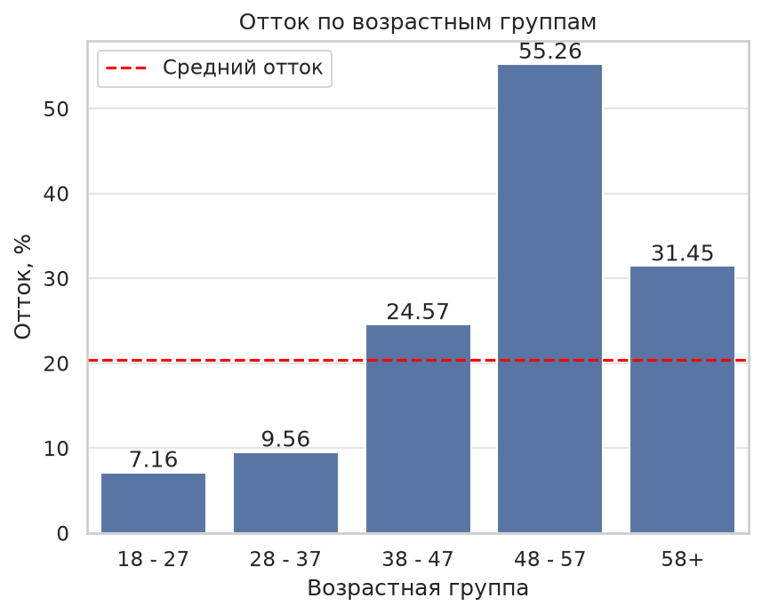
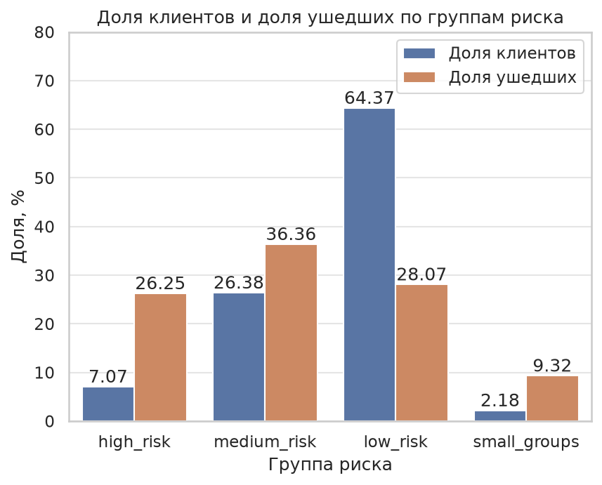
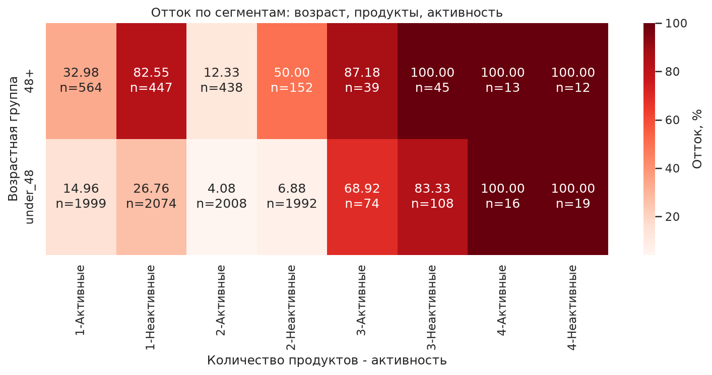

# Анализ оттока клиентов банка

Обезличенные данные о 10 000 клиентах банка, из них ушли 20,38%. Удержать клиента дешевле, чем привлечь нового, поэтому цель проекта - выявить тех, кто уходит, и предложить решение этой проблемы.

Мы проанализировали отток с помощью SQL, графиков, статистических тестов и ML, а также составили дизайн A/B-теста. Весь анализ с пояснениями к каждому шагу находится в ноутбуке [analysis.ipynb](notebooks/analysis.ipynb).

**Стек:** Python, pandas, SQL (DuckDB), matplotlib, seaborn, scipy, statsmodels, scikit-learn, Jupyter

## Главные находки

- сильнее всего отток связан с возрастом и количеством продуктов: отток выше среднего начиная с 42 лет, пик приходится на группу 48 - 57 лет (55,26%), а клиенты с 3 и 4 продуктами уходят аномально часто (82,71% и 100%);
- неактивные клиенты уходят почти в 2 раза чаще, чем активные (26,87% против 14,27%), а отток у женщин на 8,6 процентного пункта больше, чем у мужчин;
- тип карты и оценка удовлетворенности на отток не влияют;
- группа высокого риска - это 7,07% клиентов, но она дает 26,25% всех ушедших клиентов;
- градиентный бустинг находит уходящих клиентов лучше, чем правило high_risk: среди 142 клиентов тестовой выборки с самой высокой вероятностью ухода ушли 90,85%, а в группе high_risk - 80,28%.

<p>
  
  
</p>

## Рекомендации

- в первую очередь работать с клиентами, у которых вероятность ухода по бустингу 0,7 и выше, так как отток в этой группе 90,79%;
- перед запуском предложения удержания проверить его с помощью A/B-теста, для снижения оттока на 10 процентных пунктов нужно 186 клиентов в каждой группе;
- предложить программы реактивации неактивным клиентам, особенно от 48 лет, так как у клиентов от 48 лет с 1 продуктом отток неактивных 82,55% против 32,98% у активных;
- предложить кросс-продажи клиентам с 1 продуктом, так как у клиентов с 2 продуктами отток на 20,1 процентного пункта ниже.

## Ограничения

- признак Complain почти полностью совпадает с уходом клиента, скорее всего, это утечка данных, поэтому в моделях его не использовали;
- клиентов с 3 и 4 продуктами всего 326, поэтому выводы по ним предварительные;
- границы группы high_risk и порог 0,7 подбирались с учетом тестовой выборки, поэтому на новых клиентах результат может быть немного хуже;
- данных реального эксперимента нет, поэтому A/B-тест только спроектирован.

## Ход работы

### SQL

Сначала сформулировали 6 гипотез, для каждой записали обоснование и что предложить банку, если она подтвердится. Проверяли их запросами в DuckDB прямо по DataFrame.

| Гипотеза | Результат |
|---|---|
| клиенты с несколькими продуктами уходят реже | подтверждается частично: с 2 продуктами отток 7,60% против 27,71% с 1 продуктом, но с 3 и 4 продуктами - 82,71% и 100% |
| неактивные клиенты уходят чаще | подтверждается: 26,87% против 14,27% |
| чем выше статус карты, тем ниже отток | не подтверждается: отток во всех группах 19-22% |
| отток различается у мужчин и женщин | подтверждается: 25,07% у женщин и 16,47% у мужчин |
| клиенты младше 37 лет уходят чаще | не подтверждается, эффект обратный: 8,68% против 30,38% у клиентов от 37 лет |
| клиенты с оценкой удовлетворенности 1-2 уходят чаще | не подтверждается: 20,93% против 20,02% |

Также проверили, можно ли считать счета с нулевым балансом спящими. Активность у клиентов с нулевым и ненулевым балансом почти одинаковая (51,78% и 51,36%), поэтому назвать такие счета спящими нельзя. При этом отток клиентов с ненулевым балансом больше на 10,3 процентного пункта.

Для сегментирования сгруппировали клиентов по возрасту (до 48 лет и от 48), количеству продуктов и активности. Группам с оттоком от 50% дали метку high_risk, от 25% - medium_risk, остальным - low_risk. Группы, где клиентов меньше ста, отметили как small_groups, так как по ним нельзя надежно определить риск. В high_risk попали неактивные клиенты от 48 лет с 1-2 продуктами и неактивные клиенты младше 48 лет с 3 продуктами.

В запросах использовались GROUP BY, CASE WHEN, UNION ALL, CTE и оконные функции. Основные запросы собраны в [sql/queries.sql](sql/queries.sql).

### Визуализация

Построили графики оттока по возрастным группам, по возрасту, по количеству продуктов, по активности и по группам риска, тепловую карту по сегментам и распределение возраста у ушедших и оставшихся клиентов. На большинстве графиков для сравнения показан средний отток по банку.

Графики подтвердили выводы SQL-анализа и добавили несколько деталей. Отток становится стабильно выше среднего начиная с 42 лет, а пик приходится на 56 лет. Медианный возраст ушедших клиентов 45 лет, оставшихся 36 лет. На тепловой карте хорошо видно, что у неактивных клиентов от 48 лет с 1 продуктом отток крайне большой по сравнению с группами сопоставимого размера.



### Статистика

Различия между группами могли получиться случайно, поэтому проверили их статистическими тестами. Для категориальных признаков использовали критерий хи-квадрат и V Крамера, для числовых критерий Манна-Уитни, так как он не требует нормального распределения. На возрасте статистику U и p-value посчитали вручную через ранги и сверили с функцией mannwhitneyu, U совпало (11 878 815). Всего провели 14 тестов, поэтому применили поправку Бонферрони: 0,05 / 14 ≈ 0,0036.

После поправки значимыми остаются Complain, NumOfProducts, Geography, IsActiveMember, Gender, Age и Balance. Из категориальных признаков сильнее всего с оттоком связано количество продуктов (V Крамера 0,39), дальше идут страна (0,17), активность (0,16) и пол (0,11). Из числовых сильнее всего связан возраст: в 73% пар ушедший клиент старше оставшегося. Кредитный рейтинг формально значим (p-value 0,02), но эффект очень маленький, и после поправки он перестает быть значимым.

### ML

В SQL-анализе клиенты разделены на группы риска, а модель дает каждому клиенту свою вероятность ухода, поэтому всех клиентов можно отсортировать от самого рискового к самому надежному.

Перед обучением проверили признак Complain: из 2044 жаловавшихся клиентов ушли 2034, а из 7956 не жаловавшихся всего 4. Скорее всего, жалоба фиксируется в момент ухода клиента, то есть в момент прогноза ее еще нет, поэтому в модель этот признак не взяли.

Данные разделили на обучающую и тестовую выборки 80/20 с сохранением доли ушедших. Accuracy для оценки не подходит: модель, которая про всех говорит, что они останутся, угадывает 79,6% клиентов, но не находит ни одного ушедшего. Поэтому смотрели на ROC-AUC, precision и recall.

| Модель | ROC-AUC | Precision | Recall |
|---|---|---|---|
| Логистическая регрессия | 0,78 | 0,62 | 0,21 |
| Градиентный бустинг | 0,88 | 0,79 | 0,51 |

Бустинг оказался лучше по всем метрикам. У логистической регрессии вес количества продуктов почти равен 0 (-0,06), так как отток по продуктам сначала падает с 27,71% до 7,60%, а потом растет до 82,71% и 100%, и такую связь она не видит. Для бустинга это второй по важности признак (0,30) после возраста (0,39).

Затем сравнили модели с правилом high_risk из SQL-анализа. В тестовой выборке в high_risk попали 142 клиента, поэтому для каждой модели взяли столько же клиентов с самой высокой вероятностью ухода.

| Способ | Клиентов | Ушли | Доля ушедших |
|---|---|---|---|
| Градиентный бустинг | 142 | 129 | 90,85% |
| Правило high_risk | 142 | 114 | 80,28% |
| Логистическая регрессия | 142 | 89 | 62,68% |

При том же числе клиентов бустинг находит на 15 ушедших больше, чем правило. Логистическая регрессия оказалась хуже правила, так как правило построено на сочетаниях признаков, которые она не видит.

### A/B-тест

Модель находит клиентов, которые скорее всего уйдут, но не показывает, поможет ли им предложение удержания. Данных реального эксперимента нет, поэтому составили дизайн теста.

В тест берем клиентов с вероятностью ухода по бустингу 0,7 и выше. В тестовой выборке таких 152 (7,6%), из них ушли 90,79%, на всю базу это около 760 клиентов. Их случайно делим на 2 группы: контрольная ничего не получает, тестовая получает предложение удержания, например, повышенный кэшбэк. Основная метрика - отток за 90 дней после предложения. Guardrail-метрика - стоимость удержания одного клиента, она не должна быть выше дохода, который банк получает от клиента.

Размер выборки посчитали при alpha = 0,05 и мощности 0,8:

| Снижение оттока | Клиентов в каждой группе | Всего клиентов |
|---|---|---|
| на 15 процентных пунктов | 93 | 186 |
| на 10 процентных пунктов | 186 | 372 |
| на 5 процентных пунктов | 643 | 1286 |

Снижение на 10 процентных пунктов и больше можно найти сразу, а для снижения на 5 процентных пунктов клиентов не хватит, и тест придется продлить.

## Структура проекта

```
bank-churn-analysis/
├── data/                  # датасет (в репозиторий не загружен)
├── images/                # графики из ноутбука
├── notebooks/
│   └── analysis.ipynb     # основной ноутбук
├── sql/
│   └── queries.sql        # SQL-запросы
└── requirements.txt
```

## Как запустить

1. Скачать датасет [Bank Customer Churn](https://www.kaggle.com/datasets/radheshyamkollipara/bank-customer-churn) с Kaggle и положить файл `Customer-Churn-Records.csv` в папку `data/`.
2. Установить зависимости (проект делался на Python 3.14):

```bash
python -m venv .venv
source .venv/bin/activate
pip install -r requirements.txt
```

3. Открыть `notebooks/analysis.ipynb` в Jupyter.
